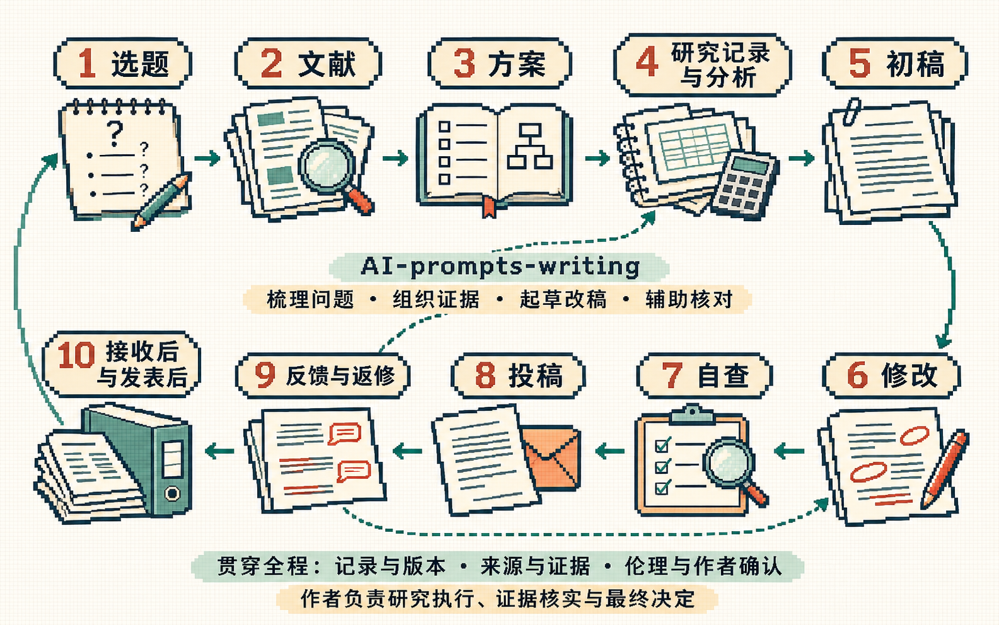

# 流程来源与任务覆盖

核对日期：2026-11-05。对应当前 README 的十阶段与 44 段写作提示词（含总写作要求，不含安装示例）。

2026-11-10补入[长报告修改经验](editorial-lessons.md)，保留十阶段与43个单项任务。[各语言README](translations.md)按相同编号提供任务，已有[5个英文任务的直接行为试跑](validation/runs/2026-11-10-en/README.md)，其余英文任务仍待测试。新增语言译文尚未做行为测试，不能沿用中英文用例的效果判定。

这里采用“从问题到材料，再到写作、出版与后续处理”的路线，方便按手头材料找入口。它由本项目综合整理，不是某个机构发布的统一流程，也不是按部就班的研究标准。选题、文献、研究与改稿经常往返；选刊也可以在前期开始。

## 依据哪些资料

| 实际查阅的来源 | 用它核对什么 | 使用边界 |
| --- | --- | --- |
| [CU Boulder：The Research Lifecycle](https://www.colorado.edu/crdds/what-we-do/research-lifecycle) | 规划、研究开展、保存与发表；提醒我们补上采集、分析、可视化和记录 | 是大学提供研究支持的框架，不是所有学科的强制顺序 |
| [NIST Research Data Framework 2.0](https://doi.org/10.6028/NIST.SP.1500-18r2) | 数据的规划、获取、处理分析、保存和复用 | 管理数据的框架不能代替论文写作方法或研究设计 |
| [DCC：Curation Lifecycle Model](https://www.dcc.ac.uk/node/64613) | 从前期就保留来源、描述和保存安排，贯穿各阶段 | 不把研究归档简化为最后上传一个文件 |
| [COS：Preregistration](https://www.cos.io/initiatives/prereg) | 区分事前计划、事后探索与实际变更 | 预注册不是所有研究的通用门槛；不能在事后补造事前记录 |
| [EQUATOR：Reporting Guidelines](https://equator-network.org/reporting-guidelines/index.html) | 根据研究类型选报告要求，核对方法和结果是否交代充分 | 主要服务健康研究；报告清单不是设计或质量评价工具 |
| [CRediT：Contributor Roles](https://credit.niso.org/contributor-roles-defined/) | 按实际工作整理贡献，反查资料整理、验证、分析和可视化是否遗漏 | 贡献分类不决定作者资格、名单或排序 |
| [Wiley：Author Journey](https://static.wiley.com/author-journey/) | 选刊、准备、提交、评审、返修与分享 | 出版路径可能拒稿、转投或再次返修，不能画成必然录用的流水线 |
| [Springer Nature：Publish an article](https://www.springernature.com/gp/authors/publish-an-article) | 接收后仍有出版与校样环节 | 具体要求以实际期刊为准 |
| [PLOS：Open Science and Editorial Policy](https://plos.org/open-science-policies/) | 声明、材料共享与发表后问题处理 | 不把一家出版方的政策当作所有期刊要求 |

这些来源用于查漏补缺，不表示相关机构认可本项目。页面可能更新，具体投稿要重新核对目标期刊当前文件。

## 从原有八阶段补了什么

| 环节 | 原有入口与缺口 | 本次补充 | 提示词能够帮助完成的部分 |
| --- | --- | --- | --- |
| 选题与定位 | 已有候选方向、问题与贡献 | 研究类型适配，按资源判断可行性 | 形成可检索、可讨论的候选问题；新颖性仍需调查 |
| 文献 | 已有检索与阅读比较 | 2.3 相关工作成文；7.4 文献身份和论断支持核对 | 从材料写出有来源的比较，区分题录、摘要、全文与未核实信息 |
| 方案 | 已有方案、大纲和证据安排 | 3.5 权限、研究记录、分析计划与时间状态；3.1 按研究方式调整 | 整理待决定事项、可行方案和记录安排 |
| 研究与证据 | 从方案直接跳到初稿 | 新增第四阶段：记录、分析/论证检查、图表图注 | 把实际材料组织成可追溯的证据，发现缺口；实际研究仍需实施 |
| 初稿 | 已有各章节任务 | 单项防编造、材料指令隔离、冲突处理；方法适配 | 基于已有材料写正文，缺证据的地方保留待补 |
| 修改 | 已有结构与语言修改 | 6.6 翻译、6.7 分章工作记录；准确文字允许保留 | 实际改稿，减少不必要的改写，追踪待同步章节 |
| 自查 | 已有事实、审稿视角和综合检查 | 7.4 引用核验、7.5 报告完整性 | 找出有依据的问题；只对实际读取范围下结论 |
| 投稿 | 主要是参考文献格式和投稿信 | 8.3 期刊与提交材料、8.4 实际贡献和声明 | 对照真实要求列材料状态，未知事实由作者确认 |
| 反馈 | 已有理解意见、改正文和回复 | 返修可回到前期；转投时重新比较要求 | 将意见转成动作，依据实际修改回复 |
| 接收与发表后 | 尚无专门入口 | 第十阶段：校样、归档/复用、更正沟通 | 核对版本、整理共享条件与错误影响，不代替正式流程 |

## 按研究方式选择证据

| 研究方式 | 常见材料与核对对象 |
| --- | --- |
| 定量实证 | 设计、测量、数据处理、比较条件、分析假设、不确定性与替代解释 |
| 质性 | 取样、访谈或档案来源、编码和解释、研究者立场、反例与引文位置 |
| 理论或证明 | 定义、假设、推导、论证范围、反例与相关理论 |
| 综述 | 检索范围、纳入排除、筛选与提取、证据评价与结论异质性 |

这是输入提示，不能替代学科方法。系统综述、临床试验、正式证明等要求较强的研究，只能由本项目提供部分组织和写作帮助。

## 覆盖到了什么，仍缺什么

现有入口横跨常见的研究准备、写稿、改稿、提交与后续核对。我们没有有代表性的用户任务调查，因此不能用这份目录证明“覆盖了大部分”，也不公布覆盖百分比。新增任务是否好用，还需真实使用反馈和更多行为测试。

目前未提供完整的经费申请、实验操作、原始数据采集、统计计算、系统综述筛选执行、形式化证明、专业伦理/版权判断、期刊投稿系统操作及出版协议处理。提示词可以整理有关材料，但这些工作不会因为生成一段文字就自动完成。

不同学科的本地实践、毕业论文学校要求、中文期刊与跨语言写作，仍需要真实案例扩充。公开资料也不能保证所有文献都可访问；不能访问的部分必须保留未核实状态。

## 怎么判断提示词是否可靠

“文字里写了禁止编造”属于设计约束，不是有效性的证据。当前把输入字段、输出要求和边界逐项审查，再用固定案例作行为初测；具体方法、原始输出、判定和未测试任务都在[验证记录](validation/README.md)。

插图是基于上述映射生成的像素手稿风格项目说明图，不含真实实验数据，也不代表出版方背书。原始生成说明见[绘图提示词](../assets/research-writing-lifecycle-prompt.md)。
