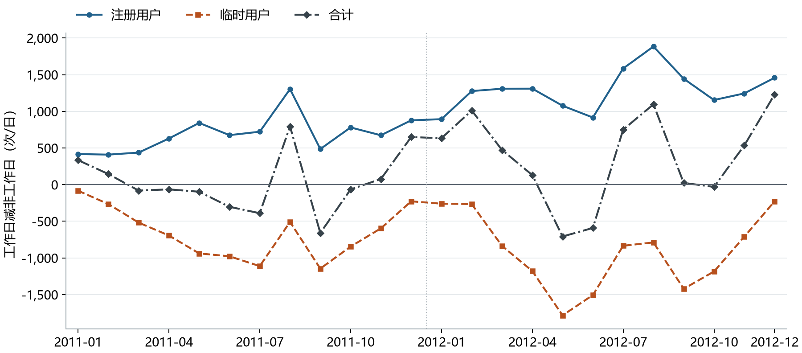
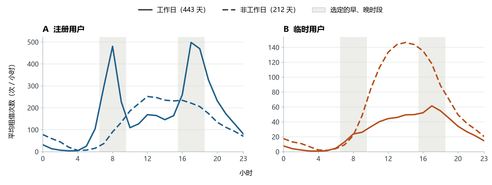

# 华盛顿共享单车的工作日差异集中在哪些时段？基于两年日记录和小时记录的分析

## 摘要

华盛顿 Capital Bikeshare 在工作日的日均租借总量较高。这个差额能否代表两类用户各自的使用情况，又来自一天中的哪些时间？本文使用 2011—2012 年的 731 条日记录和 17,379 条小时记录，分别计算注册用户、临时用户和全系统在工作日与非工作日的租借量差值。两年合并，工作日平均每天多 254.7 次租借，其中注册用户多 1019.2 次，临时用户少 764.6 次。逐月比较，两类用户的差值在全部 24 个月里方向相反，全系统却有 10 个月在工作日租得更少。在早晚六个小时均有记录的 725 天里，注册用户在这六小时的工作日日均租借量多 1232.3 次，在其余时段少 187.1 次。按相同的月份构成比较、剔除节假日，或限定在有同类天气记录的日期比较，两类用户的日均差值仍方向相反。结果表明，全系统的日均差额同时掩盖了用户之间和时段之间的抵消。用它描述历史用量时，需要同时说明比较的是哪类用户、一天中的哪段时间。

**关键词**　共享单车；租借次数；工作日；日内变化；华盛顿

## 1　引言

如果工作日平均每天比非工作日多出两百多次共享单车租借，人们很容易把它读成“工作日用车更多”。这句话作为系统总量的描述是准确的，却无法回答两个实际问题：临时用户是否也在工作日租得更多？即使是注册用户，工作日的用量是否从早到晚都较高？对编制月度运营报告的人来说，这两点关系到如何解释数字。同一项日均差额，既可能来自全天平缓的增加，也可能来自早晚的集中增加和其余时段的减少。两种情况会引导读者关注不同的时段。

已有研究提供了区分用户类别的理由。Buck 等人分别现场访问了华盛顿的一日票用户、在线调查了年度会员，发现受访短期用户比年度会员更常出于休闲目的骑行。与此相关的当地会员调查也记录了通勤以外的出行。问卷能够直接询问骑行目的，租借记录则能连续覆盖不同日期，但会员身份本身无法说明某次行程的目的。Younes 等人分析了 2018 年 12 月至 2019 年 6 月在华盛顿特区内出发或结束的行程，发现有桩共享单车会员的用量在高峰时段尤其集中，非会员的用量在周末较高。这些研究说明用车时段与用户类别有关，尚不能据此算出早晚增量在全天净差中占多少。[Buck 等，2013][@buck2013users] · [会员调查摘要，2012][@lda2012survey] · [Younes 等，2020][@younes2020temporal]

本文关注同一套早期运营记录中三个相互关联的问题。先看日总量把方向相反的两部分抵消了多少，再观察这种关系是全年合并后才出现，还是在同一个月里也反复出现。最后，将小时记录与日记录逐日对齐，判断工作日多出的注册租借发生在何时。这样，同一组数据既能检验“工作日较多”在哪种尺度上成立，也能给出这句话在何时、对谁不成立的具体例子。

## 2　数据与方法

### 2.1　资料来源与观察单位

数据来自 UCI 机器学习库的 *Bike Sharing*。它收录了华盛顿地区 Capital Bikeshare 系统在 2011 年 1 月 1 日至 2012 年 12 月 31 日的日汇总和小时汇总。Fanaee-T 与 Gama 的配套研究曾用这批运营日志研究事件标注。本文采用数据集中的临时用户（`casual`）和注册用户（`registered`）两列。运营方按用户所购票种分类，这两列并不记录行程目的。日表以整个系统的一天为一行，小时表以一天中的一个钟点为一行。两张表都计租借次数，同一个人在同一天可以租借多次。文中“注册用户多租了多少次”均指这一类别的总次数。[UCI 数据与变量表][@fanaee2013bike] · [数据集配套研究][@fanaee2014event] · [运营方字段说明][@cabiSystemData]

日表有 731 个互不重复的日期，两个年度之间没有断档。我们逐日核对了临时与注册两列之和，结果每天都等于总量。按档案的标记，工作日指周一至周五中未列为节假日的日期，非工作日包括周末和标记的节假日。以日历星期和节假日字段分别核对，得到 500 个工作日和 231 个非工作日。因此，以下“非工作日”也涵盖落在周一至周五的节假日。

小时表有 17,379 个不同的“日期、钟点”组合。若每个日期都列出 0 至 23 时，会有 165 个组合在表内找不到。我们分别对临时、注册和总次数按日加总，所有日期的小时记录之和都与日表吻合。这样的核对说明两张表对已记录租借的汇总一致，无法解释某些钟点为何少了一行。涉及具体时段的比较因而按实际可用的日期纳入样本。

### 2.2　日均差、用户构成与月内比较

每类日期的日均租借量等于该类日期的租借总次数除以天数。三张表所列差值均取工作日均值减非工作日均值，单位为次/日。两组的天数不同，直接比较两组的总次数会把可观察的日期长短也算进差异。分析用户构成时，分母另取该类日期的全部租借次数，求其中注册租借所占的比例。这给每次租借相同的权重，回答的是随机取出一笔记录时它属于哪一类用户。

同一年也有淡旺月份。如果两类日期在各月的分布不同，把两年直接合并，两组均值就会给各月不同的权重。我们在每个“年、月”内部先算日均差，再按该月占全部观察天数的比例加权。设第 $m$ 个月的工作日和非工作日均值分别为 $\bar y_{m,W}$ 和 $\bar y_{m,N}$，该月共有 $n_m$ 天，则全期的月内加权差为

$$
D=\sum_{m=1}^{24}\frac{n_m}{731}\left(\bar y_{m,W}-\bar y_{m,N}\right).
$$

按这个方法，2011 年 5 月的两类日期使用同一个权重；2012 年 5 月则按它在整个时期所占的天数另算。这样，次年整体用量上升时，两个年份的同一月份也不会被合并在一起。除加权均值外，我们保留了所有月份的差值和方向，便于判断一个两年平均数对单个月份有多大代表性。

### 2.3　节假日、天气与小时覆盖

非工作日同时包含普通周末和节假日。我们剔除所有标记为节假日的日期，重新比较普通工作日与普通周末。另一项敏感性分析按年月进一步区分日表记录的天气类别。Gebhart 与 Noland 将华盛顿的逐小时天气与行程相连，发现降雨等天气条件与较低的用车可能性相关。这给了我们一个具体的比较理由：即使在同一月，两类日期遇上不同天气的机会也可能不同。[Gebhart 与 Noland，2014][@gebhart2014weather]

天气比较只使用同年月、同天气类别下工作日和非工作日都有记录的组合，并按各组合保留的日数重新计算权重。我们还在这批完全相同的日期上重复一次仅按年月的分析。这样可以区分两种变化：删去缺少对照的日期会改变结果，在留下的日期上细分天气也会改变结果。各分析的差额均先用原始计数计算，再取一位小数。

小时分解选择早上 07:00 至 10:00 前、下午 16:00 至 19:00 前，即钟点标签 7、8、9 和 16、17、18。两类用户在所有日期都采用相同的钟点。每天先把各窗口内的租借次数相加，再在同一组日期中算工作日日均差。其余时段的已记录次数由日总量减去两个窗口的次数得到。窗口以外的钟点即使有缺行，也不补记为零。窗口分解纳入六个钟点都有记录的日期，绘制 24 小时曲线则要求当日所有小时都有记录，以保证曲线上每个点都来自同一组日期。这些分析是在已有日均结果基础上开展的探索性比较，所报告的差值描述指定观察期内的实际用量。

## 3　结果

### 3.1　两类用户的工作日差值在每个月都相反

合并两年，系统从非工作日的日均 4330.2 次上升到工作日的 4584.8 次。注册用户由 2959.0 次增至 3978.3 次，临时用户则由 1371.1 次降至 606.6 次。换成租次构成，注册用户占非工作日全部租次的 68.34%，占工作日的 86.77%，相差 18.43 个百分点。因而，工作日的租借总量略高，注册租借在全部租次中所占的比例也更高。

**表 1　工作日与非工作日的日均租借量差值（次/日）**

| 观察期 | 工作日/非工作日（天） | 临时用户差值 | 注册用户差值 | 合计差值 |
| --- | ---: | ---: | ---: | ---: |
| 2011 年 | 250/115 | −647.4 | +708.7 | +61.2 |
| 2012 年 | 250/116 | −879.5 | +1335.9 | +456.4 |
| 两年合并 | 500/231 | −764.6 | +1019.2 | +254.7 |

分项与合计分别四舍五入到一位小数。两年合并时，每一天在对应日类型内权重相同。

年度汇总中两个年份的合计差值均为正，但逐月结果并不都是如此（图 1）。注册用户的工作日租借量在 24 个月里都较高，临时用户都较低，两项相加后只有 14 个月为正，其余 10 个月为负。以 2012 年为例，5 月注册用户在工作日日均多租 1076.2 次，仍不足以抵消临时用户少租的 1783.5 次，合计少了 707.4 次。到同年 8 月，两组差值的方向如前，注册用户日均多出的 1884.1 次超过了临时用户少租的 788.5 次，合计转为多 1095.5 次。总量翻转不要求任何一类用户改变方向，只需要两项差值的相对大小改变。

**图 1　各月工作日减非工作日的日均租借次数。** 每个点使用相应年、月内该类日期的全部记录。零线以上表示工作日日均租借量较高。点和连线呈现观测均值差，未估计置信区间。

### 3.2　改变月份、节假日和天气的比较口径

给两类日期相同的月份权重后，系统的工作日日均差由 +254.7 收窄至 +205.2 次。进一步剔除全部 21 个标记的节假日，余下 500 个工作日和 210 个普通周末日，月内加权的合计差值为 +166.8 次（表 2）。因此，把节假日与周末合并确实关系到合计差额有多大。在这两种比较中，注册用户的正差和临时用户的负差都保留下来。

**表 2　不同日期范围及加权方法下的工作日日均差（次/日）**

| 比较口径 | 天数 | 临时用户差值 | 注册用户差值 | 合计差值 |
| --- | ---: | ---: | ---: | ---: |
| 直接合并 | 731 | −764.6 | +1019.2 | +254.7 |
| 按年月比较 | 731 | −788.9 | +994.1 | +205.2 |
| 剔除节假日，按年月比较 | 710 | −808.4 | +975.3 | +166.8 |
| 天气有可比记录的日期，按年月比较 | 708 | −793.7 | +1031.7 | +238.0 |
| 同一批日期，按年月和天气比较 | 708 | −756.1 | +1039.3 | +283.2 |

在实际出现的 60 个年月与天气组合中，48 个同时有工作日与非工作日记录，覆盖 481 个工作日和 227 个非工作日。在这同一批日期上，按年月比较得到 +238.0 次，继续在同类天气下比较得到 +283.2 次。临时和注册用户仍分别为负差和正差。部分天气组合的一侧只有一个观察日，其均值就是那一天的用量。因此，这一比较能说明结果对分组口径有多敏感，无法给出天气对租借量的独立作用。

### 3.3　注册租借的工作日增量集中在早晚六小时

早晚六个钟点均有记录的日期共 725 天，包括 495 个工作日和 230 个非工作日。注册用户上午三小时在工作日日均多租 705.2 次，下午三小时多租 527.1 次，两段合计多租 1232.3 次。然而，同一批日期里注册用户的全天差值只有 +1045.2 次。原因可以直接从其余时段读出：去掉这六小时后，注册用户在工作日日均少租 187.1 次（表 3）。这里的“集中”有明确的数量含义，六小时内的增量约为全天净增量的 1.18 倍，超出的部分在其余时段被抵消。

**表 3　在相同的 725 天内按时段分解工作日日均差（次/日）**

| 时段 | 临时用户差值 | 注册用户差值 | 合计差值 |
| --- | ---: | ---: | ---: |
| 上午三小时 | −15.3 | +705.2 | +689.9 |
| 下午三小时 | −168.9 | +527.1 | +358.2 |
| 两个时段合计 | −184.2 | +1232.3 | +1048.1 |
| 其余时段 | −579.5 | −187.1 | −766.7 |
| 全天 | −763.7 | +1045.2 | +281.5 |

每格是一个工作日相对一个非工作日在该时段内相差的租借**次数**。上午和下午两行合为“两个时段合计”，再与“其余时段”合为“全天”，均按未舍入的数值相加。表 1 覆盖全部 731 天，表 3 的全天一行只对应这 725 天。

临时用户的差额分布不同。上午三小时，临时用户在工作日与非工作日的日均租借量分别为 58.9 和 74.2 次，相差 −15.3 次。两个窗口以外的时段合计相差 −579.5 次，构成了临时用户全天负差的主要部分。把用户类别再次合并，系统在早晚六小时于工作日多租 1048.1 次，在其余时段少租 766.7 次。当运营汇总只提供该批日期全天多出的 281.5 次时，这两段方向相反的差别都会被折进同一个数字。

**图 2　全天小时记录齐全的日期中，两类用户的逐小时平均租借次数。** 每个点为相应钟点的次/小时，工作日 443 天，非工作日 212 天。阴影为表 3 的早晚窗口。两面板纵轴刻度不同，跨面板比较用量需读刻度。

在这 655 个全天小时齐全的日期里，注册用户的工作日曲线在 8 时和 17 时分别达到早晚局部峰值，平均每小时 480.3 次和 498.1 次；非工作日的注册曲线在 12 时达到最高点。非工作日临时租借则在 14 时达到最高点。只用这组日期重算，注册用户早晚窗口内的工作日日均差为 +1309.3 次，窗口外为 −174.7 次，与表 3 方向一致。全天记录不齐的 76 天里有 60 天来自 2011 年，限制样本也改变了两年的构成，因而不能将图 2 的各小时均值直接当作整个两年的水平。

## 4　讨论

两年的日记录给出了一个容易误读的结果。全系统在工作日的用量平均较高，两类用户中却只有注册用户符合这个描述。将观察尺度缩小到单月，注册与临时两类的方向仍然稳定，合计指标反而有近半数月份转为负值。对于按月阅读的运营报告，两年平均值可以说明每个工作日平均比一个非工作日多完成多少次租借。要了解一个具体月份，还需要同时看到两类用户各自的日均差。2012 年 5 月和 8 月的反向结果表明，同一城市、同一年度内，这一点也不能省略。

小时分解进一步限定了可以怎样解释注册用户的正差。早晚窗口内，工作日比非工作日多出的注册租借量已经超过全天净差。窗口之外，即使只看注册类别，方向也翻转了。若据全天均值推断“注册用户在工作日的各个时段都租得更多”，就会误判其余时段合计差额的方向；窗口外各个钟点仍有高低之分。2018—2019 年华盛顿会员在高峰时段的集中使用，为图 2 的形态提供了一个可比较的观察。两项研究的时期、纳入行程和会员口径都不同，这种对照能支持提出关于用车时段的问题，还不足以判定多年间差额是否增减。[Younes 等，2020][@younes2020temporal]

早晚双峰也不能直接换算成通勤次数。2011 年的当地会员调查询问受访者最近一次共享单车出行，56% 的回答属于非工作目的。调查中的每位受访者回答一次，运营日志则会多次计入经常租车的人。直接用这一调查比例乘以工作日租借次数，会把按人数和按租次计算的比例混在一起。要把系统差额进一步分解到通勤、办事或休闲，需要能记录出行目的的调查，并处理自愿回答调查的人与全部用车人之间的区别。[会员调查摘要，2012][@lda2012survey]

两张汇总表还限定了这些数字的运营用途。表中的一次租借是已经发生的交易，没有记下到站却没找到车的人，也没有区分始发站和到达站。早晚总量的差异能指出值得查看的时间段，要确定哪些站点缺车、需要调多少辆，还要结合站点库存及进出站方向。对照同年同月和粗略天气类别，能减少两类日期构成不同带来的部分影响，但同一月内的活动安排、气温差异和系统供给仍可能与用量有关。本文完整描述这两年的存档记录，未将日期视为独立随机抽样，也未将日历分类解释为工作安排的因果效应。

## 5　结论

华盛顿 Capital Bikeshare 在 2011—2012 年的工作日日均总量略高。全期数据中，注册租借的增加被临时租借的减少部分抵消。在六个钟点齐全的 725 天里，注册用户内部还出现了另一层抵消：早晚时段的增加被其余时段的减少部分抵消。对这套系统而言，按用户类别和时段一起报告，可以读出全天总量里看不到的两项变化，也便于区分哪些问题能由运营日志回答，哪些还需要查站点库存或询问骑行者。

## 数据与复现

Hadi Fanaee-T 提供的数据按 CC BY 4.0 许可发布。原始日表、压缩的原始小时表、产生统计结果的代码与独立验表脚本均随文提供。逐格核对覆盖表 1 至表 3 的年份、用户类别、时段和差值。[数据与复算步骤](README.md) · [资料查阅记录](sources.md)

## 参考文献

1. Buck D, Buehler R, Happ P, Rawls B, Chung P, Borecki N. 2013. Are Bikeshare Users Different from Regular Cyclists? A First Look at Short-Term Users, Annual Members, and Area Cyclists in the Washington, D.C., Region. *Transportation Research Record*, 2387(1), 112–119. [期刊原文][@buck2013users]
2. LDA Consulting. 2012. *Capital Bikeshare 2011 Member Survey: Executive Summary*. Capital Bikeshare. [调查报告][@lda2012survey]
3. Younes H, Zou Z, Wu J, Baiocchi G. 2020. Comparing the temporal determinants of dockless scooter-share and station-based bike-share in Washington, D.C. *Transportation Research Part A: Policy and Practice*, 134, 308–320. [作者机构存档][@younes2020temporal]
4. Fanaee-T H. 2013. *Bike Sharing* [数据集]. UCI Machine Learning Repository. [数据集 DOI](https://doi.org/10.24432/C5W894)
5. Fanaee-T H, Gama J. 2014. Event labeling combining ensemble detectors and background knowledge. *Progress in Artificial Intelligence*, 2, 113–127. [期刊原文][@fanaee2014event]
6. Gebhart K, Noland RB. 2014. The impact of weather conditions on bikeshare trips in Washington, DC. *Transportation*, 41, 1205–1225. [期刊原文][@gebhart2014weather]
7. Capital Bikeshare. *System Data*. Member Type 字段说明。[运营方公开数据说明][@cabiSystemData]

[@buck2013users]: https://journals.sagepub.com/doi/10.3141/2387-13
[@lda2012survey]: https://d21xlh2maitm24.cloudfront.net/wdc/Capital_Bikeshare_2011_Survey_Executive_Summary.pdf?mtime=20161206135934
[@younes2020temporal]: https://geog.umd.edu/sites/geog.umd.edu/files/pubs/1-s2.0-S0965856419311553-main_0.pdf
[@fanaee2013bike]: https://archive.ics.uci.edu/dataset/275/bike+sharing+dataset
[@fanaee2014event]: https://link.springer.com/article/10.1007/s13748-013-0040-3
[@gebhart2014weather]: https://link.springer.com/article/10.1007/s11116-014-9540-7
[@cabiSystemData]: https://capitalbikeshare.com/system-data
