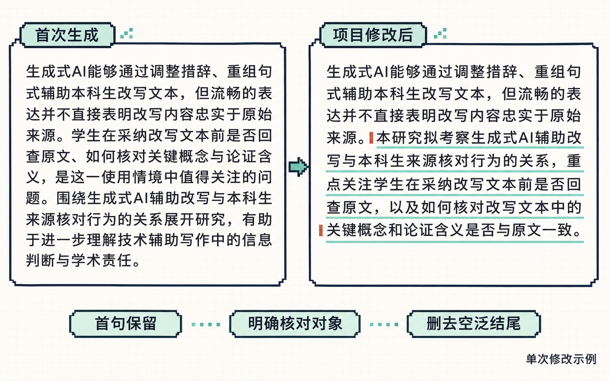

# 短引言的修改记录

[English](README.en.md) · [返回项目首页](../../README.md#showcase)

2026-11-10，先用一个普通写作请求生成短引言，再用项目 Skill 与 6.2 润色任务修改。两次分别使用新的子代理上下文。这里保存第一次生成的正文和一次修订的完整结果。

## 固定的初稿请求

```text
请写一段约150字的中文论文引言。主题是生成式AI辅助改写与本科生核对原始来源的行为。论文处于研究准备阶段，目前只确定这个主题，尚无文献、研究方案或结果。请只给正文。
```

执行者仅接收这一写作请求，以及读取和保存文件的要求。没有要求故意写出缺点，也没有从多份初稿里挑选。

## 首次生成

生成式AI能够通过调整措辞、重组句式辅助本科生改写文本，但流畅的表达并不直接表明改写内容忠实于原始来源。学生在采纳改写文本前是否回查原文、如何核对关键概念与论证含义，是这一使用情境中值得关注的问题。围绕生成式AI辅助改写与本科生来源核对行为的关系展开研究，有助于进一步理解技术辅助写作中的信息判断与学术责任。

[查看首次输出快照](draft-before.md)

## 使用项目修改后

生成式AI能够通过调整措辞、重组句式辅助本科生改写文本，但流畅的表达并不直接表明改写内容忠实于原始来源。本研究拟考察生成式AI辅助改写与本科生来源核对行为的关系，重点关注学生在采纳改写文本前是否回查原文，以及如何核对改写文本中的关键概念和论证含义是否与原文一致。

[查看完整修订请求](revision-input.md) · [查看完整修订输出](draft-after.md)

修订请求使用了当日的 `.agents/skills/ai-prompt-writing/SKILL.md` 与任务 6.2，并明确仅有主题和原稿，研究仍处准备阶段。允许细化核对的含义，具体观察方式留待决定。

## 实际改了哪里

| 位置 | 原始表达 | 修订动作与理由 |
| --- | --- | --- |
| 首句 | 流畅的表达并不直接表明改写内容忠实于原始来源 | 完整保留，原句已经交代了表达流畅与来源忠实度之间的区别 |
| 中段 | 如何核对关键概念与论证含义 | 明确为核对改写文本中的概念和论证是否与原文一致，指出核对对象和比较关系 |
| 研究目的 | 围绕……展开研究，有助于进一步理解……学术责任 | 改为“本研究拟考察”，把研究关系放在具体问题之前，删去尚未展开说明的意义总结 |

初稿已经使用谨慎措辞，修订集中于指代、顺序和信息密度。具体观察方法、资料与结果仍需作者准备。原稿首句是研究场景的背景表述，在正式论文中也需要根据目标期刊和文献补充适当依据。

## 图文对应



图中的两段文字对应上述快照。英文图和英文文字是这次中文记录的翻译，由本次助手整理，英文生成和改稿效果尚未单独测试。绘制说明见[生成提示词](../../assets/showcase-before-after-prompt.md)。

## 演示的范围

两次运行均使用本次 Codex 的默认模型环境，没有联网、数据分析或文献核验。精确 API 模型标识、采样参数和随机种子未固定。修订阶段读取项目 Skill 和提示词，无法把变化单独归因于某条规则。一次修改示例适合逐句观察，效果仍需要真实作者和更多材料评价。

11 月 8 日的旧展示已由这次记录替换。旧初稿任务曾要求呈现常见缺陷，绘图时也没有输入完整原文，导致图文不一致。旧版本可在 Git 历史中查看，本次从中性请求重新记录前后输出。

这里公开的主题、输入和示例均为重新编写，历史项目仅用于归纳编辑检查项。[查看经验整理](../editorial-lessons.md)
